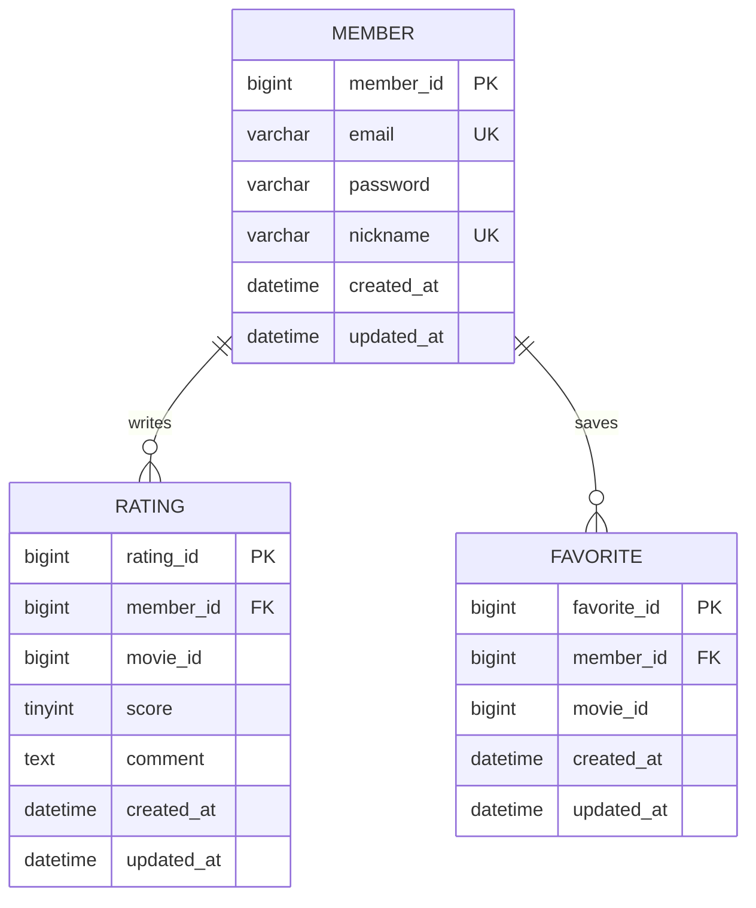

# Week 05 — 영화 평점 서비스와 실제 웹 연결

[워크북](https://app.notion.com/p/5-API-86f1d799147b83179bd3013b5209d1c7)의 **실습 0~3과 필수 미션**을 Spring Boot 3.5.0 / Java 21로 구현했다. week03~04의 도서 프로젝트를 수정하지 않고 `week05`에 새 영화 도메인 프로젝트를 만들었다. 선택 미션인 형식 검증·페이지네이션은 추가하지 않았다. CodeRabbit 리뷰는 생략한다.

## 설계와 핵심 코드

회원의 email·nickname은 각각 UNIQUE이며, 한 회원은 여러 평점과 즐겨찾기를 갖는다. movieId는 TMDB 식별자를 담는 일반 컬럼이며 우리 DB의 영화 FK가 아니다. Favorite은 워크북 지시대로 스키마만 준비하고 Entity·API는 구현하지 않았다.



평점·즐겨찾기는 각각 `(member_id, movie_id)` 복합 UNIQUE 제약을 둔다. [스키마](sql/01_schema.sql)와 [더미 데이터](sql/02_seed.sql)는 워크북 SQL을 사용한다. 비밀번호 더미 문자열은 로그인용 실제 비밀번호나 유효한 bcrypt 해시가 아니다.

| 계층 | 직접 작성한 코드 |
|---|---|
| Entity | [BaseTimeEntity](src/main/java/com/umc/movie/entity/BaseTimeEntity.java), [Member](src/main/java/com/umc/movie/entity/Member.java), [Rating](src/main/java/com/umc/movie/entity/Rating.java) |
| DTO | [NicknameCheckResponse](src/main/java/com/umc/movie/dto/NicknameCheckResponse.java), [EmailCheckResponse](src/main/java/com/umc/movie/dto/EmailCheckResponse.java), [RatingResponse](src/main/java/com/umc/movie/dto/RatingResponse.java) |
| Repository | [MemberRepository](src/main/java/com/umc/movie/repository/MemberRepository.java), [RatingRepository](src/main/java/com/umc/movie/repository/RatingRepository.java) |
| Service | [MemberService](src/main/java/com/umc/movie/service/MemberService.java), [RatingService](src/main/java/com/umc/movie/service/RatingService.java) |
| Controller | [MemberController](src/main/java/com/umc/movie/controller/MemberController.java), [RatingController](src/main/java/com/umc/movie/controller/RatingController.java) |
| CORS | [WebConfig](src/main/java/com/umc/movie/config/WebConfig.java) |
| 실제 웹 | [화면](frontend/index.html), [세 API fetch·렌더링](frontend/app.js), [스타일](frontend/style.css) |

## API 명세

모든 API는 인증 없는 GET이며 Body는 없다. 기본 서버 주소는 `http://localhost:8080`이다.

| 이름 | Method / URL | 입력 | 성공 응답 |
|---|---|---|---|
| 닉네임 중복 체크 | `GET /members/nickname/{nickname}` | Path string | `200`, `{"available": boolean}` |
| 이메일 중복 체크 | `GET /members/email/{email}` | Path string | `200`, `{"available": boolean}` |
| 유저별 평점 | `GET /members/{memberId}/ratings` | Path number | `200`, 아래 DTO 배열 |

`available`은 중복이면 false, 사용할 수 있으면 true이다. 한글·이메일 경로는 `encodeURIComponent`로 인코딩하고 큰따옴표는 값에 넣지 않는다.

평점 응답 필드는 `ratingId`(number), `movieId`(number), `score`(number), `comment`(string 또는 null), `createdAt`·`updatedAt`(ISO 날짜 문자열)이다. ratingId 내림차순이며 회원의 평점이 없으면 `[]`, 회원 자체가 없으면 `404`, memberId가 숫자로 변환되지 않으면 `400`이다. Entity·비밀번호를 JSON 응답에 노출하지 않는다.

## 실행 방법

아래 명령은 `week05`에서 실행한다. 로컬 MySQL에 새 데이터베이스 `umc_movie`를 만들고 sql/01_schema.sql, sql/02_seed.sql을 순서대로 한 번 적용한다. 기존 테이블에 중복 실행하지 않는다.

```powershell
$env:DB_URL = 'jdbc:mysql://localhost:3306/umc_movie'
$env:DB_USER = '본인_DB_사용자'
$env:DB_PASSWORD = '본인_DB_비밀번호'
.\gradlew.bat bootRun
```

별도 터미널에서 실제 웹 서버를 실행한다.

```powershell
python -m http.server 5173 --bind 127.0.0.1 --directory frontend
```

`http://localhost:5173`에서 닉네임·이메일을 확인하고 회원 번호로 평점을 조회한다. 화면은 별도 출처의 Spring API에 직접 fetch하며 프록시·정적 응답을 사용하지 않는다. 허용 출처는 `http://localhost:5173`이며 `127.0.0.1:5173`은 다른 Origin이다.

## 격리 실행과 재현

```powershell
.\gradlew.bat build --no-daemon
python validation\verify_mysql.py --serve --cors-disabled
```

설치된 MySQL 실행 파일을 사용해 임시 MySQL 서버와 새 DB에 스키마·시드를 가져온다. 기존 사용자 DB에 접속하지 않는다. `MYSQL_BIN`으로 MySQL 실행 파일 폴더를, `JAVA_HOME`으로 JDK를 지정할 수 있다. API 테스트 기본 포트는 18085, 웹 포트는 5173이다. 이미 사용 중인 포트에서는 중단한다.

1. `http://localhost:5173/?api=http://localhost:18085`에 접속해 세 버튼을 누른다. CORS가 꺼져 있어 응답을 읽지 못한다.
2. `Set-Content .validation-runtime/stop stop`으로 API·MySQL·웹 서버를 함께 종료한다.
3. `python validation/verify_mysql.py --serve`로 CORS가 켜진 서버를 시작한다.
4. 같은 화면을 새로고침하고 세 버튼을 다시 누른다. 정상 응답을 확인한다.
5. 인증이 끝나면 다시 stop 파일을 생성한다.

일반 실행에서는 CORS가 기본으로 켜져 있다. `CORS_ENABLED=false`는 실습 0 재현용이다. `ddl-auto: validate`와 `open-in-view: false`를 사용한다.

## 인증 자료

- [CORS 설정 전 화면](results/browser-cors-before.png), [실제 브라우저 콘솔 오류](results/browser-cors-before-console.json), [동시에 성공한 서버 직접 요청과 CORS 헤더 부재](results/cors-before-http.json)
- [CORS 설정 후 세 API를 연결한 실제 웹 화면](results/browser-all-apis.png)
- [Postman 닉네임 — URL·JSON](results/postman-nickname.png)
- [Postman 이메일 — URL·JSON](results/postman-email.png)
- [Postman 평점 목록 — URL·JSON](results/postman-ratings.png)
- [Postman 없는 회원 — 404](results/postman-missing-member.png)
- [실제 HTTP 검증](results/http-results.json), [검증 요약](results/verification.json), [Postman Collection](postman/week05.postman_collection.json)

Postman PNG는 실제 웹 Postman과 Desktop Agent로 호출한 화면이며, 별도의 자동 HTTP 결과를 Postman UI로 꾸미지 않았다. 웹 캡처도 세 API의 실제 fetch 결과다.

## 진행 기록 및 검증

1. 워크북을 읽고 이슈 #6, `week5/6-mission` 브랜치를 생성했다. 실습 0~3도 모두 진행하라는 사용자 지시를 반영했다.
2. 새 영화 프로젝트와 전체 ERD·스키마, Member/Rating Entity·Repository·DTO·Controller/Service를 구성했다.
3. 회원 확인과 영화 평점 화면을 작성하고 요청 중·정상·오류·빈 목록 상태를 처리했다.
4. CORS를 끄고 직접 HTTP 호출은 성공하지만 브라우저에서는 세 요청이 `Failed to fetch`가 되는 것을 확인했다. 콘솔의 실제 TypeError와 응답에 허용 Origin 헤더가 없는 기록을 저장했다.
5. 같은 화면에서 CORS를 켠 서버를 호출하고 세 API의 정상 응답을 확인했다. 중복 여부 두 경우, 회원별 데이터 분리, 최신순, 빈 목록, 404·400, 허용 출처 GET·preflight 및 다른 출처 거부를 검증했다.
6. Java 21 Gradle 빌드가 성공했고, CORS 설정 전 HTTP 10개 및 설정 후 HTTP 12개 검증이 통과했다. JUnit 테스트 대신 실제 MySQL과 HTTP를 사용하는 통합 스크립트 및 브라우저 조작으로 확인했다. 실제 화면에서도 사용 가능·중복·평점 없음·없는 회원·정상 평점 표시를 각각 확인했다.

**검증:** 실제 MySQL·Postman·브라우저에서 명세의 세 API가 동작하며, CORS 설정 후 별도 출처의 실제 웹 화면이 응답을 읽고 표시하는 것을 확인했다.
