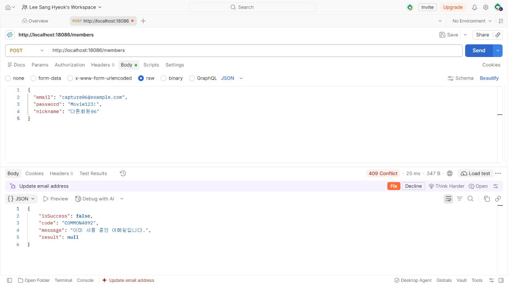
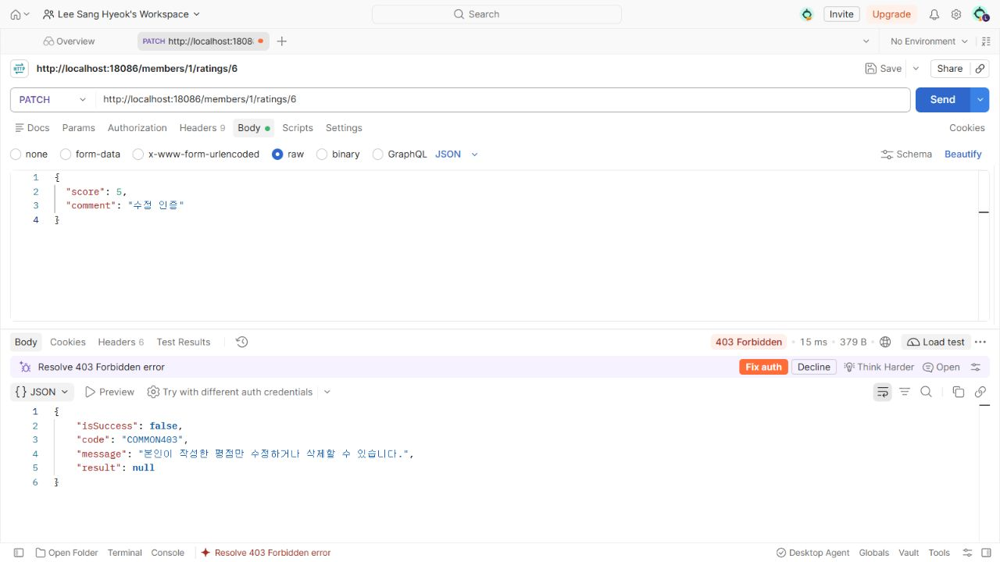
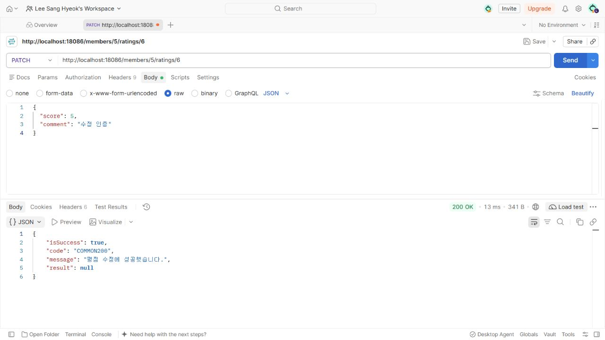
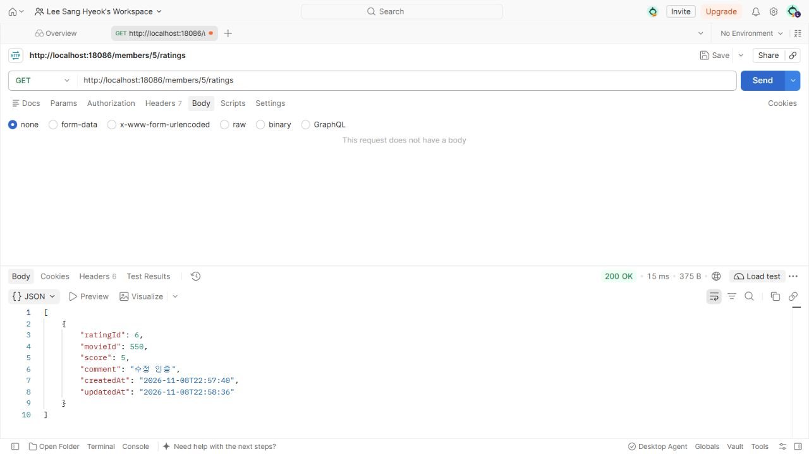
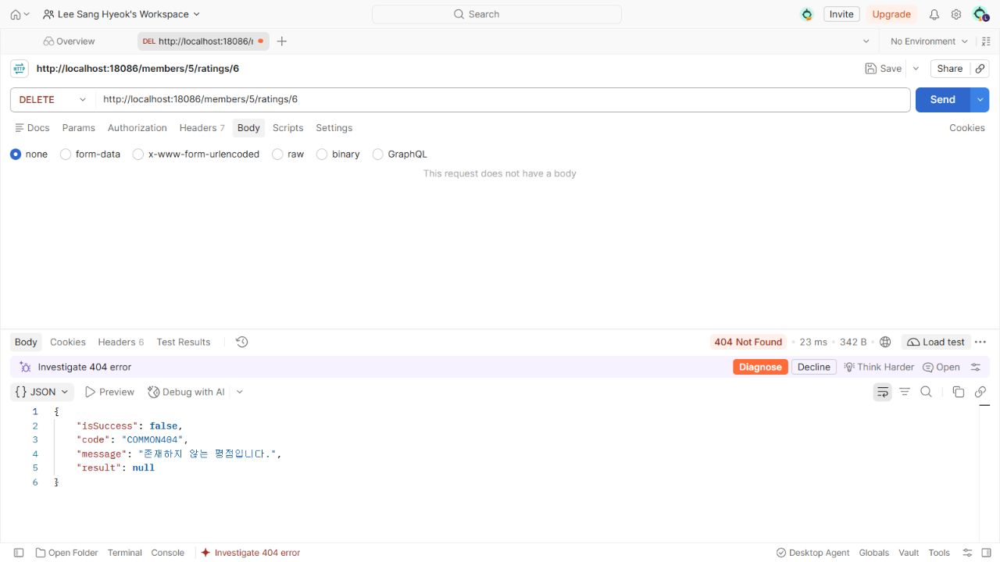
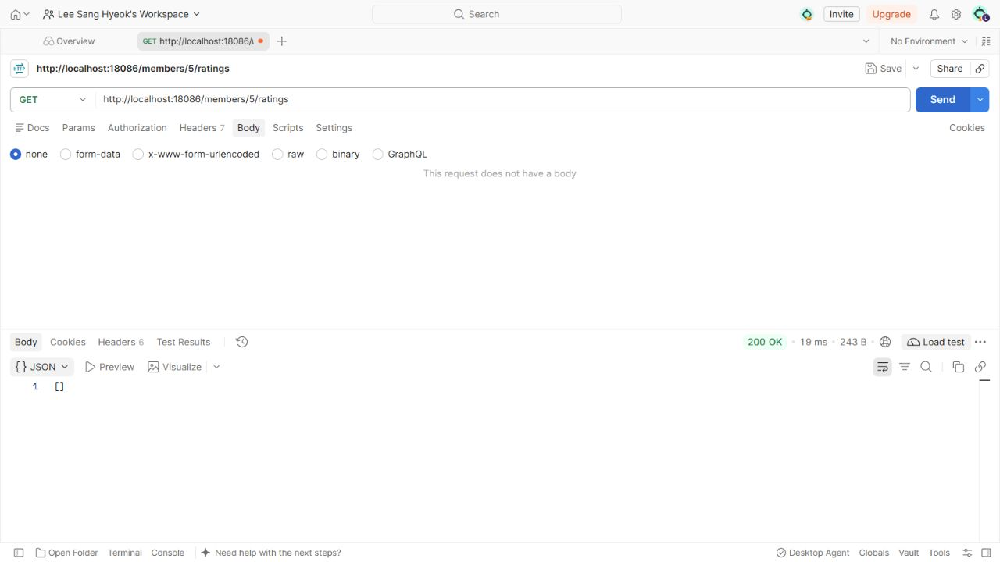

# 필수 Standard Mission 기록

## 요구사항과 구현

- 회원가입: DTO 검증 → 이메일/닉네임 중복 확인 → bcrypt 해시 저장 → password 없는 MemberResponse와 201.
- 평점 등록: 회원 존재 확인 → (member_id, movie_id) 중복 확인 → 저장 후 ratingId와 201.
- 평점 수정·삭제: ratingId 조회 → 소유자 memberId 비교 → 수정 200 또는 삭제 204.
- 오류: DTO/JSON 400, 중복 409, 다른 소유자 403, 없는 자원 404를 공통 ApiResponse로 처리.
- [API 명세](api-spec.md), [핵심 코드 전체 텍스트](core-code.md), [자동 검증 결과](../results/verification.json).

## 진행 과정

1. 최신 main을 갱신하고 이슈 #8, `week6/8-mission` 브랜치를 생성했다. 기존 주차의 코드와 미추적 파일은 보존했다.
2. week05를 기반으로 week06 프로젝트를 구성하고 crypto 의존성, 요청/응답 DTO와 전역 예외 처리, 평점 생성·변경 메서드를 추가했다.
3. 임시 MySQL에서 실행한 타입 검증이 소수 별점의 잘못된 저장을 발견했다. 아래 트러블슈팅대로 수정 후 다시 빌드하고 전체 41개 HTTP 검증을 통과했다.
4. Postman에서도 회원가입 → 입력 오류·중복 → 평점 등록 → 중복 → 다른 소유자 수정 → 정상 수정 → 재조회 → 삭제 → 없는 평점 → 빈 목록 흐름을 직접 실행했다.
5. 실습 인증은 별도 문서에 세 장으로, 필수 미션의 추가 인증은 아래처럼 상태별로 분리했다.

## Postman 요청·응답 인증

회원가입과 평점 등록의 201 캡처는 [실습 인증](practice-evidence.md)에서 함께 확인한다. 아래 Postman 요청은 실제 발급된 memberId 5, ratingId 6으로 수행했다.

| 검증 | 요청 | 실제 결과 |
|---|---|---|
| 중복 이메일 | POST /members | 409, COMMON4092 |
| 중복 평점 | POST /members/5/ratings, movieId=550 | 409, 추가 저장 거부 |
| 다른 회원 수정 | PATCH /members/1/ratings/6 | 403, COMMON403 |
| 본인 수정 | PATCH /members/5/ratings/6, score=5 | 200, COMMON200 |
| 수정 후 조회 | GET /members/5/ratings | score=5, comment=수정 인증 |
| 본인 삭제 | DELETE /members/5/ratings/6 | 204, Body 없음 |
| 삭제한 평점 재요청 | DELETE /members/5/ratings/6 | 404, COMMON404 |
| 삭제 후 조회 | GET /members/5/ratings | 200, [] |

## 필수 확인 포인트

1. **password가 응답에 없는가?** 회원가입 응답의 result 키가 memberId, email, nickname 세 개뿐임을 검사했고, DB 해시 60자와 BCryptPasswordEncoder.matches 성공도 확인했다. 같은 테스트 비밀번호의 다른 가입 해시는 서로 달랐다.
2. **중복 평점이 DB에 저장되지 않는가?** 실제 통합 검증에서 최초 등록 뒤 rating 행 수가 4였고, 같은 member/movie 재등록 409 이후에도 4였다. DB 복합 UNIQUE 제약을 유지했다.
3. **DELETE가 204인가?** HTTP 상태 204와 응답 Body 0바이트를 검사했고, MySQL에서 행이 사라진 것과 GET 목록이 빈 배열로 바뀐 것도 확인했다.
4. **실패 처리가 일관적인가?** 400/403/404/409 모두 isSuccess, code, message, result 네 필드이며 실패 result는 null이다. 타인 수정·삭제 403 이후 원본 평점이 바뀌지 않았다.

## 트러블슈팅 1건 — 소수 별점이 정수로 저장됨

- **이슈:** score=4.5를 보내면 400이어야 하는데 초기 실행에서 201이 반환되고 평점이 저장됐다. [수정 전 원본](../results/troubleshooting/fractional-score-before.json).
- **문제:** Jackson 2의 기본 소수→정수 강제 변환 때문에 Bean Validation에 전달될 때 이미 Integer 4가 되어 @Min/@Max를 통과했다. DTO를 Integer로 선언하는 것만으로 소수 입력을 막을 수 없었다.
- **해결:** `spring.jackson.deserialization.accept-float-as-int: false`로 자동 변환을 끄고 HttpMessageNotReadableException을 전역 처리하여 공통 COMMON4001 응답으로 변환했다. 같은 score=4.5 요청이 수정 후 400이 되는 것과 소수 movieId도 거부되는 것을 확인했다. [수정 후 원본](../results/troubleshooting/fractional-score-after.json).
- **참고:** [Jackson 공식 Deserialization Features](https://github.com/FasterXML/jackson-databind/wiki/Deserialization-Features).

**최종 검증:** 빌드와 실제 MySQL HTTP 41개 검증 및 Postman 실행 결과가 실습·필수 미션의 상태 코드, 입력 검증, 해시 저장, 소유권, 중복 방지와 일치했다.
