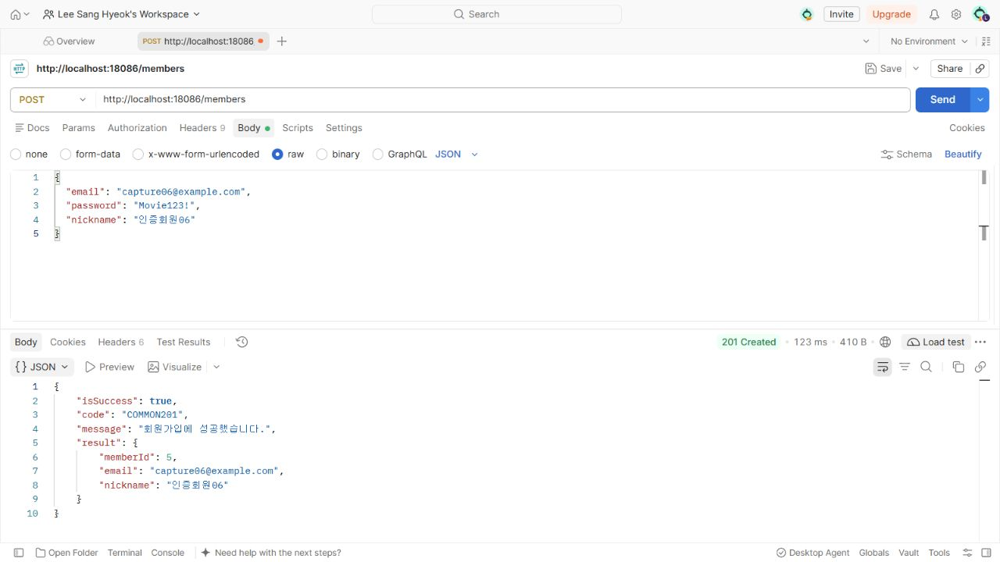
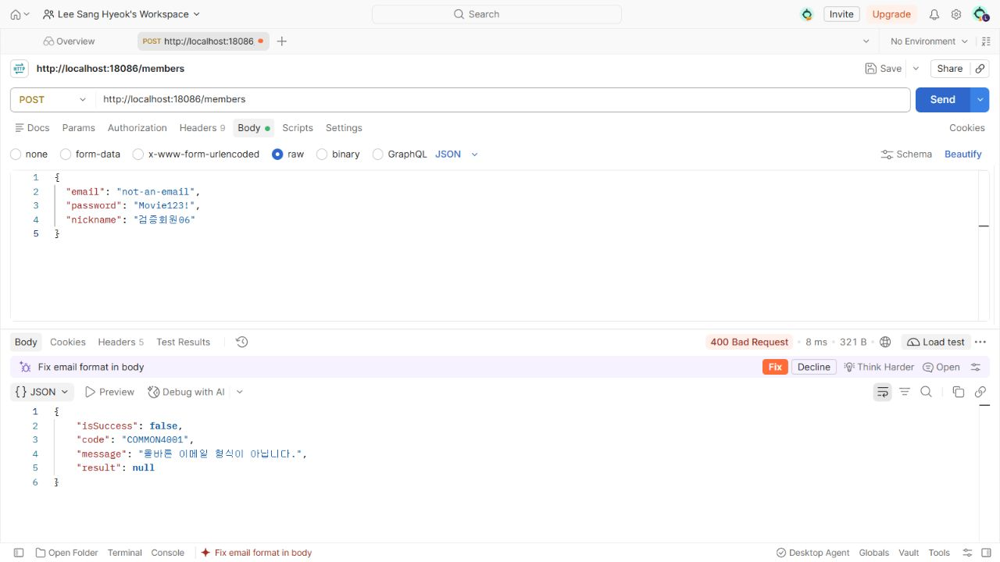
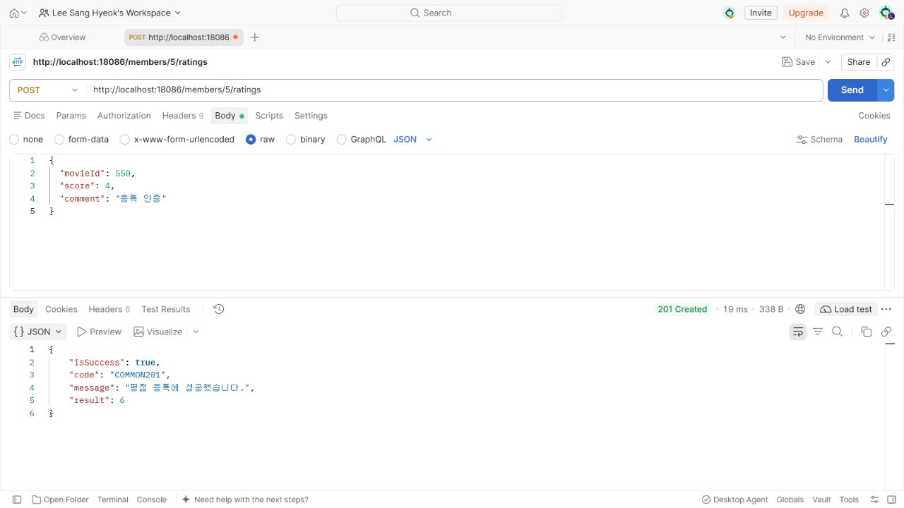

# 실습 인증

워크북이 요구한 실습 인증은 아래 세 장이다. 모두 실제 Postman 웹 + Desktop Agent에서 `localhost:18086`의 Spring Boot 서버로 요청한 화면이며, URL·Body·상태·JSON을 함께 확인할 수 있다.

## 1. 회원가입 성공

POST /members에 `capture06@example.com`, 테스트 비밀번호 `Movie123!`, `인증회원06`을 보내 201과 memberId 5를 받았다. 응답 result에는 memberId·email·nickname만 있고 password는 없다.

## 2. 검증 실패

같은 API에 email=`not-an-email`을 보내 400을 받았다. isSuccess=false, code=COMMON4001, message=`올바른 이메일 형식이 아닙니다.`, result=null로 Service 저장 전에 거부됐다.

## 3. 평점 등록 성공

POST /members/5/ratings에 movieId 550, score 4, comment=`등록 인증`을 보내 201과 ratingId 6을 받았다.

화면 인증과 별도로 회원가입 검증, bcrypt DB 저장, 평점 수정·삭제와 실패 응답까지 모두 실제 HTTP 41개와 MySQL 저장 결과로 검증했다. [검증 요약](../results/verification.json), [요청·응답 원문](../results/http-results.json).
