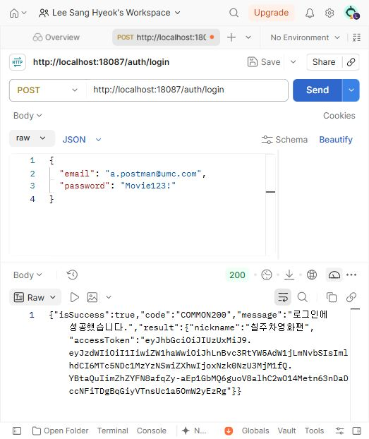
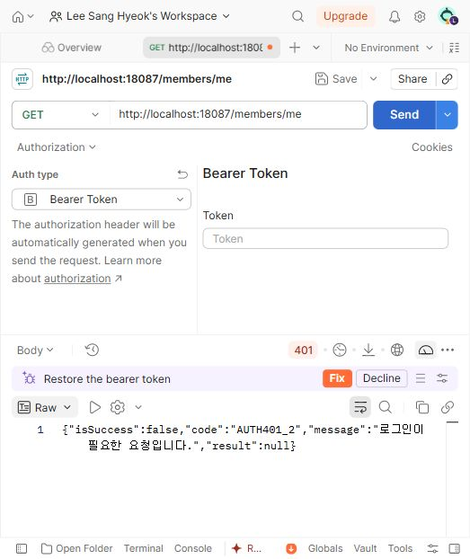
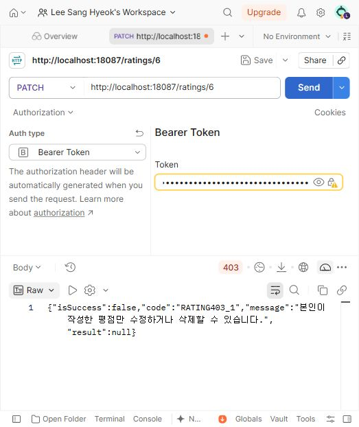
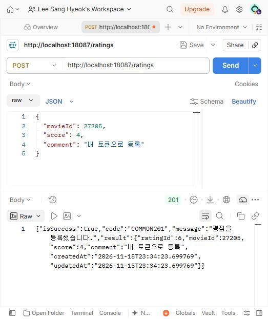

# 필수 미션 기록

`week07`에 Spring Boot 프로젝트를 만들고 6주차의 Entity·DTO·회원가입·공개 조회를 가져와 실습 1~6을 확장했다. 선택 미션과 CodeRabbit 리뷰는 제외했다.

## 구현 과정

1. JJWT 0.12.6 의존성과 JWT 환경변수를 추가했다. 실제 비밀키는 저장소에 넣지 않았다.
2. ApiException과 전역 핸들러로 도메인별 오류 코드·HTTP 상태·공통 응답을 연결했다.
3. AuthService에서 이메일 조회, bcrypt matches(), JWT 발급을 구현했다. 잘못된 이메일과 비밀번호의 실패 응답을 통일했다.
4. AuthInterceptor에서 토큰을 검증하고 memberId를 요청 속성에 저장했다. GET·PATCH /members/me에서 DTO로 본인 정보만 조회·수정하도록 했다.
5. 평점 쓰기 경로에서 memberId를 제거했다. POST /ratings와 PATCH·DELETE /ratings/{ratingId}는 토큰의 요청자를 사용하고 소유권 검사는 서비스에서 공통 처리했다.
6. 임시 MySQL에서 HTTP 검증 후 Postman에서도 두 회원으로 전체 시나리오를 순서대로 실행하고 PNG를 남겼다.
7. 수정 응답의 updatedAt 갱신 문제를 발견해 flush 후 DTO를 만들도록 고치고 최종 코드를 다시 검증했다.

## Postman 9단계 실행 결과

| 단계 | 실제 실행 | 결과 |
| --- | --- | --- |
| 1 준비 | A(a.postman@umc.com), B(b.postman@umc.com) 회원가입 | 각각 201, memberId 5·6 |
| 2 로그인 | A·B 이메일/비밀번호로 POST /auth/login | 각각 200, 토큰 A·B 발급 |
| 3 등록 | 토큰 A, POST /ratings, movieId 27205, score 4, comment | 201 / COMMON201, ratingId 6 |
| 4 중복 등록 | 같은 토큰·영화로 다시 등록 | 409 / RATING409_1 |
| 5 본인 수정 | 토큰 A, PATCH /ratings/6, score 5 | 200 / COMMON200 |
| 6 남의 것 수정 | 토큰만 B로 바꿔 같은 평점 수정 | 403 / RATING403_1 |
| 7 토큰 없이 | 토큰 제거 후 수정 | 401 / AUTH401_2 |
| 8 없는 평점 | 토큰 A, DELETE /ratings/99999 | 404 / RATING404_1 |
| 9 본인 삭제 | 토큰 A, DELETE /ratings/6 | 200 / COMMON200, result: null |

추가로 필수 제출용 GET /members/me의 토큰 없는 401, 토큰 변조 401, 내 정보 수정 200, 닉네임 중복 409와 동일한 로그인 실패 응답을 캡처했다. 실제 Postman 응답 원문은 `results/postman-scenario.json`에 있다.

## 필수 제출 PNG

## 핵심 코드

`docs/core-code.md`와 `docs/core-code.txt`에 실제 Entity, DTO, Controller, Service, Repository, JWT 도구와 인터셉터 코드를 복사 가능한 텍스트로 제공했다.

## 최종 검증

- Gradle build 성공. 별도 JUnit 테스트는 없으며 실제 HTTP·MySQL 통합 검증을 실행했다.
- HTTP 52건과 별도의 CORS preflight 검증 통과.
- 필수 9단계, 잘못된 입력, 소유권 위반 후 데이터 유지, 중복 시 행 수 유지, 삭제 후 목록을 검증했다.
- Body·query에 memberId를 추가해도 검증된 토큰의 작성자가 사용됨을 DB에서 확인했다.
- 닉네임 수정과 평점 변경이 DB에 반영되고 수정 응답의 updatedAt도 갱신됨을 확인했다.
- 캡처·검증 서버는 기존 DB와 분리했으며 캡처 종료 후 중단했다. 공개된 예시 토큰은 재사용할 수 없다.

## 트러블 슈팅

이슈: 본인 평점 수정은 성공했지만 응답의 updatedAt이 createdAt과 같은 이전 값이었다.

문제: @UpdateTimestamp는 flush 시점에 갱신되는데, save() 다음에 DTO를 먼저 만들면 트랜잭션 종료 전의 값이 복사된다.

해결: saveAndFlush() 후 RatingResponse를 생성했다. 생성과 수정 사이에 1.1초를 두고 updatedAt이 createdAt보다 증가하는지 실제 HTTP 응답으로 검증했다. 전후 JSON은 `results/troubleshooting/update-timestamp-before.json`, `update-timestamp-after.json`이다.
