# 실습 인증

실제 Postman 웹과 로컬 API를 사용한 캡처다. PNG는 화면을 합성하거나 응답을 수정하지 않고 캡처의 파일 형식만 변환했다. API 주소는 `http://localhost:18087`이며 임시 MySQL을 사용했다.

## 실습 1 — 로그인 API

A(`a.postman@umc.com`, memberId 5), B(`b.postman@umc.com`, memberId 6)를 회원가입한 뒤 각각 로그인했다. bcrypt matches()를 통과하면 JWT를 발급하고 200 / COMMON200으로 nickname과 accessToken을 반환한다. A 로그인 인증은 닉네임 수정 후 재로그인한 화면이며, 토큰 전체가 보이도록 응답 원문에 줄바꿈을 적용했다.

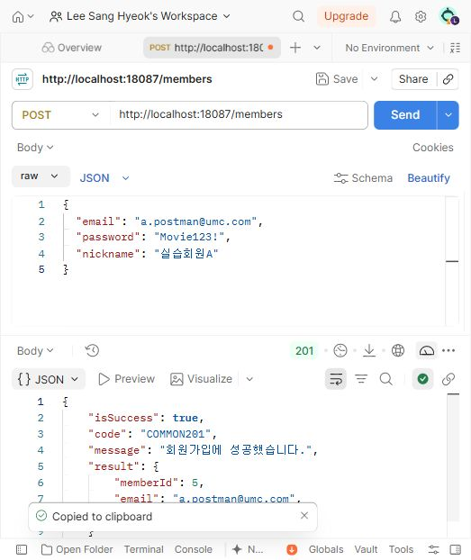

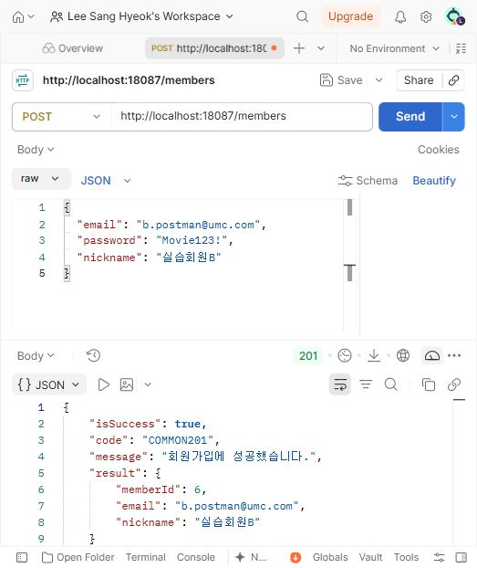

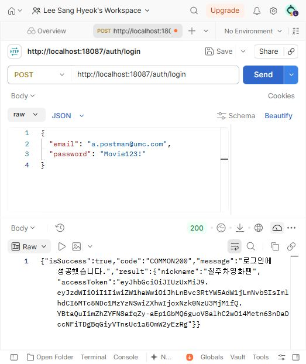

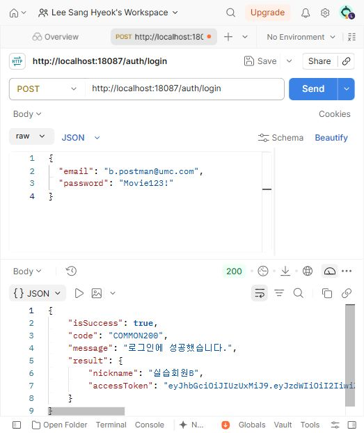

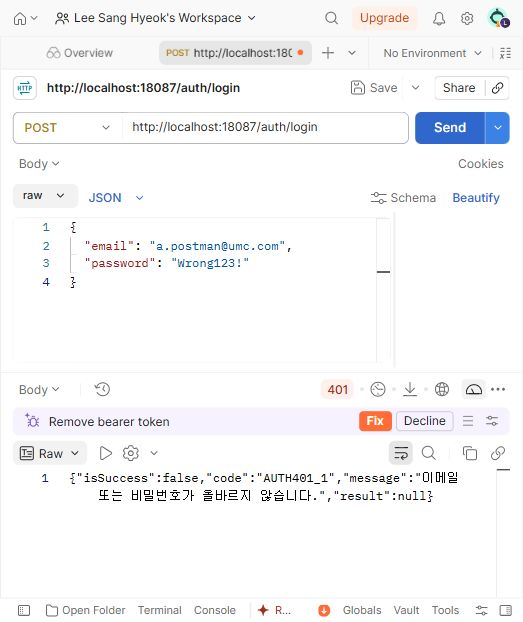

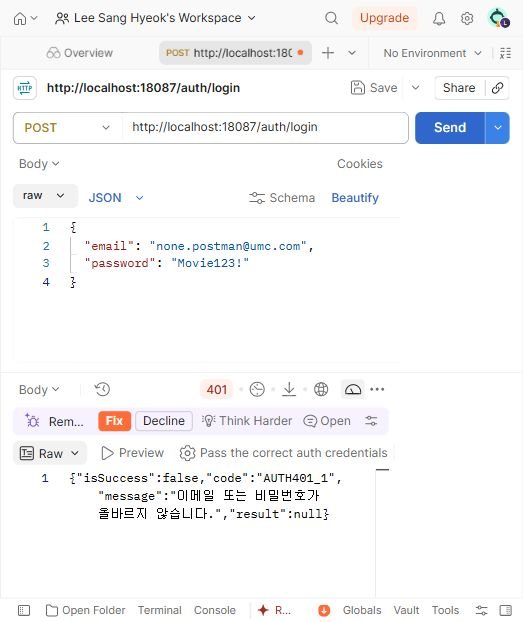

없는 이메일과 틀린 비밀번호는 모두 `401 / AUTH401_1 / 이메일 또는 비밀번호가 올바르지 않습니다.`로 동일했다. 이메일 가입 여부를 실패 응답으로 구분하지 않았다.

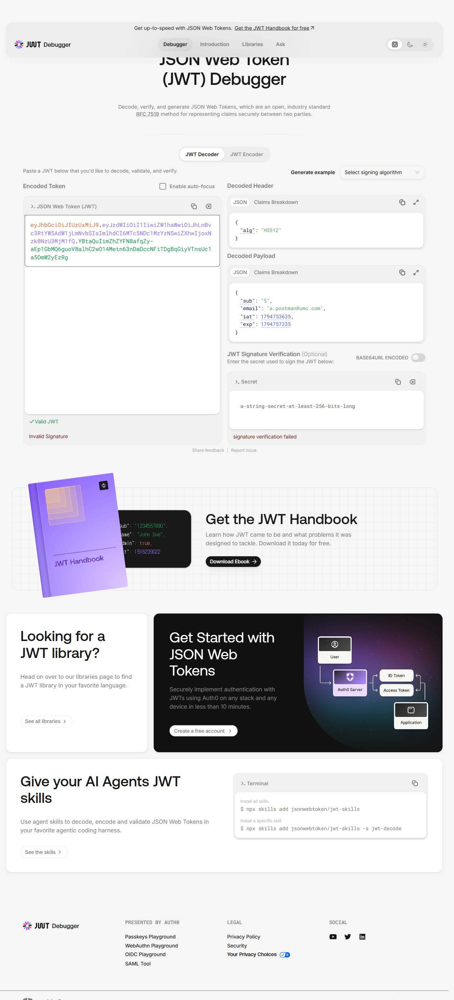

사용자가 허용한 테스트 토큰만 jwt.io에 입력했다. 실제 claim은 `sub: "5"`, `email: "a.postman@umc.com"`, `iat: 1794753635`, `exp: 1794757235`였다. `exp - iat = 3600`초이며 비밀번호는 없다. 임시 검증 키는 64자의 무작위 문자열이라 알고리즘은 HS512로 선택됐다. 서버 비밀키를 외부 사이트에 입력하지 않아 jwt.io의 기본 예시 키로는 Invalid Signature가 표시된다. 이는 디코딩 실패가 아니며, 실제 API에서는 정상 서명 통과와 payload 변조 거절을 별도로 검증했다.

## 실습 2 — 인증 관문

AuthInterceptor를 전 경로에 등록하고 로그인·회원가입·공개 조회 경로를 제외했다. Authorization 헤더에서 Bearer 토큰을 꺼내 서명·만료·필수 claim을 검사한 뒤 memberId를 request attribute에 담는다. 컨트롤러는 @RequestAttribute로 검증된 값만 사용한다. CORS OPTIONS는 토큰 없이 통과한다. 아래 실습 3의 정상·누락·변조 요청으로 관문 작동을 확인했다.

## 실습 3 — 내 정보 조회

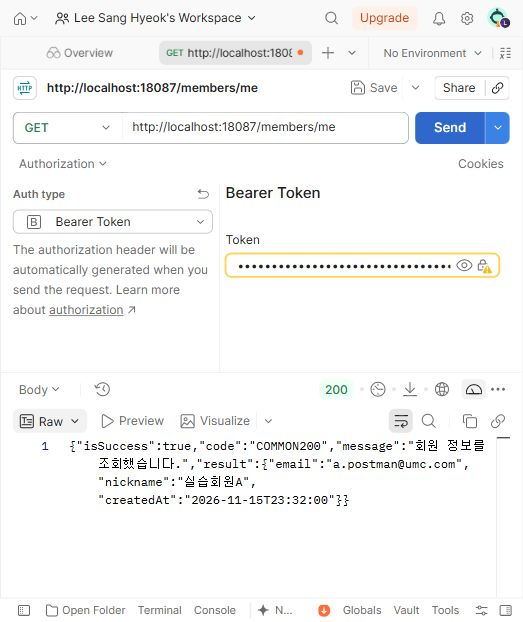

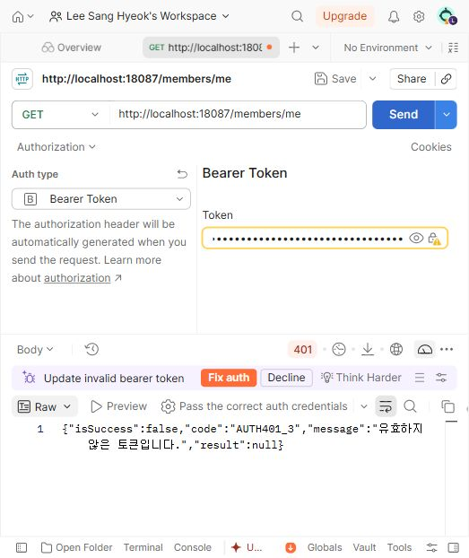

GET /members/me는 헤더가 없으면 AUTH401_2, 정상 토큰이면 email·nickname·createdAt만 반환했다. payload 가운데 한 글자를 바꾸고 서명을 유지한 토큰은 AUTH401_3으로 거절됐다.

## 실습 4 — 내 정보 수정

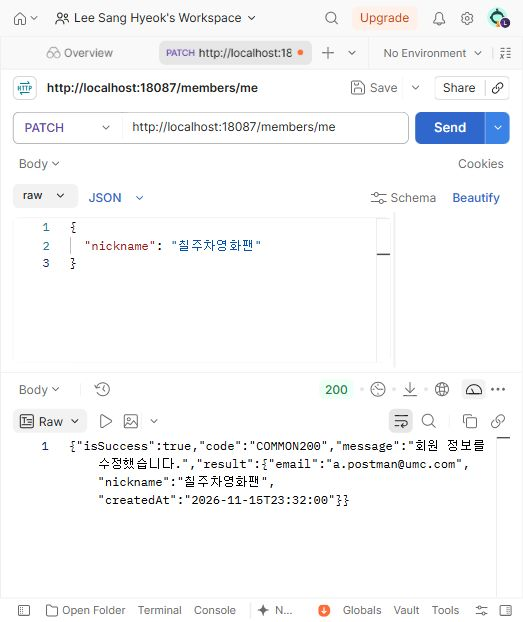

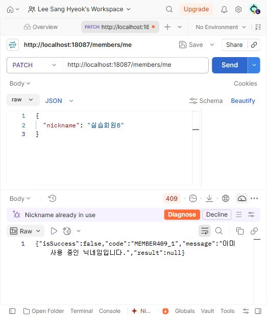

PATCH /members/me로 A의 닉네임을 `칠주차영화팬`으로 바꿨다. 본인 닉네임은 그대로 유지할 수 있고 다른 회원의 닉네임은 MEMBER409_1로 거절한다. 2~12자 제약과 재조회·DB 반영도 검증했다.

## 실습 5 — 토큰 기반 평점 CRUD

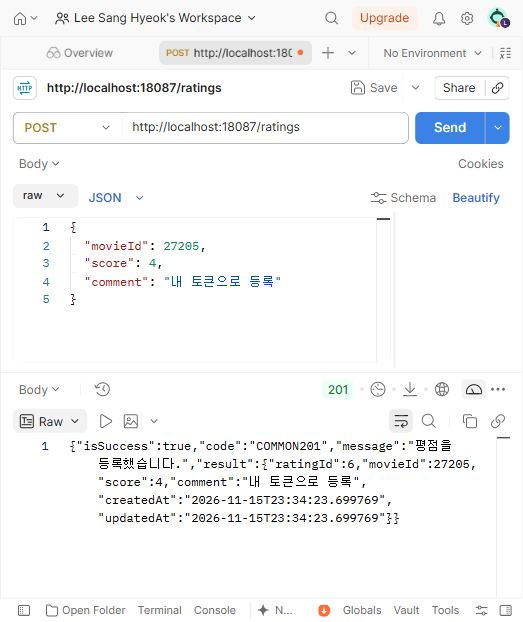

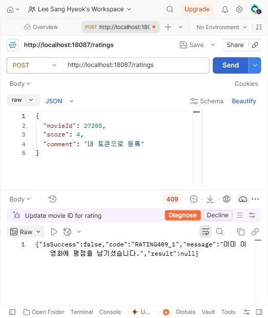

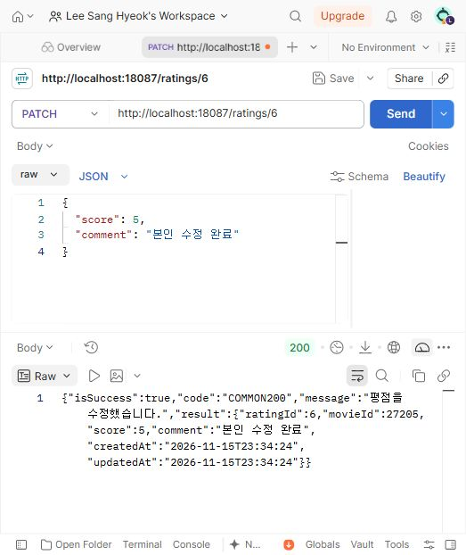

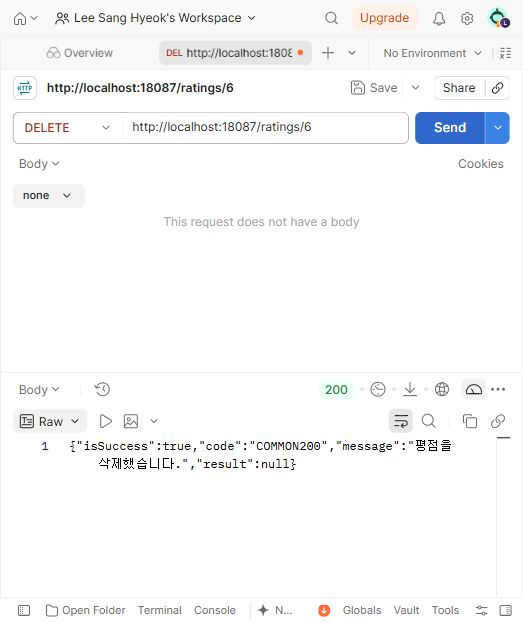

POST /ratings는 memberId 없이 movieId·score·comment만 보냈다. 작성자는 토큰 A에서 정해졌고 ratingId 6이 생성됐다. 같은 영화의 중복 요청은 RATING409_1, 본인 수정은 200, 삭제는 200 / COMMON200 / result: null이었다. 공개 회원별 조회는 유지했다.

수정 화면을 살펴보며 `updatedAt`이 이전 값으로 응답되는 현상을 발견했다. 최종 코드는 saveAndFlush() 후 DTO를 만들도록 수정했고, 최종 HTTP 검증에서는 생성 시각보다 수정 시각이 증가하는 것도 확인했다. 해당 화면은 이 수정 전 캡처이며 전후 응답 원문을 `results/troubleshooting`에 구분해 보관했다.

## 실습 6 — 401·403·404 구분

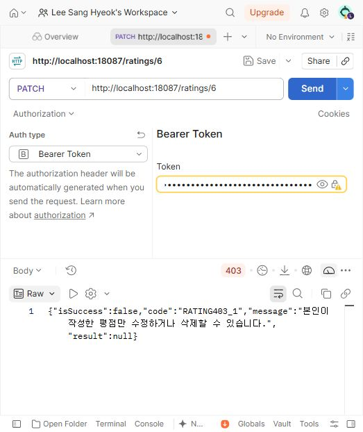

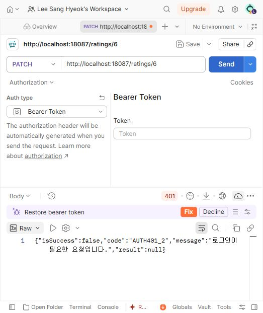

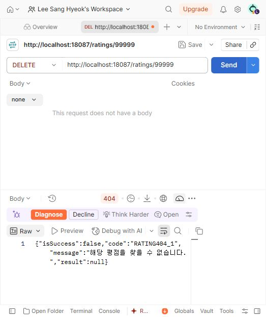

유효한 B 토큰으로 A의 평점을 수정하면 403 / RATING403_1, 토큰을 빼면 401 / AUTH401_2, 없는 평점은 404 / RATING404_1이었다. 인증은 인터셉터, 인가는 서비스의 findOwnedRating()에서 담당한다.
